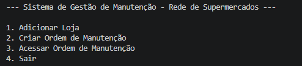
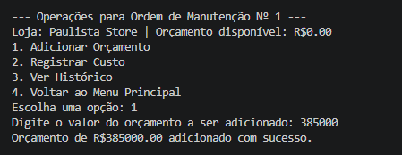
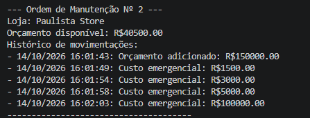

# Sistema de Gestão de Manutenção para Rede de Supermercados

[English](README.md) | [Português](README.pt-br.md)

Aplicação desenvolvida em Python para simular a gestão de manutenção de uma rede de supermercados de grande porte.

O projeto utiliza conceitos de Programação Orientada a Objetos para representar lojas, ordens de manutenção, orçamento, custos, histórico de movimentações e diferentes regras de negócio para manutenções preventivas, corretivas e emergenciais.

> **Aviso:** Este projeto é totalmente fictício e foi desenvolvido exclusivamente para fins educacionais e de portfólio. Ele não representa sistemas, processos, dados ou operações de nenhuma empresa real.

---

## Visão Geral

Grandes redes varejistas operam múltiplas lojas e dependem de diferentes tipos de infraestrutura e equipamentos para manter suas operações funcionando.

Atividades de manutenção podem envolver sistemas elétricos, refrigeração, ar-condicionado, hidráulica, equipamentos, instalações físicas e outros ativos operacionais.

Neste cenário fictício, o objetivo foi desenvolver uma aplicação capaz de organizar e controlar ordens de manutenção em diferentes unidades de uma rede de supermercados.

O sistema trabalha com três tipos de manutenção:

- Manutenção Preventiva
- Manutenção Corretiva
- Manutenção Emergencial

Cada tipo possui regras próprias de utilização de orçamento e registro de custos.

---

## Problema de Negócio

Uma rede de supermercados de grande porte pode precisar administrar diversas atividades de manutenção simultaneamente em diferentes unidades.

Sem um processo estruturado, alguns desafios podem surgir:

- dificuldade para acompanhar ordens de manutenção por loja;
- baixa visibilidade sobre orçamento e custos;
- diferentes níveis de prioridade entre tipos de manutenção;
- ausência de um histórico centralizado das intervenções;
- dificuldade para aplicar regras consistentes entre diferentes unidades.

O projeto simula como esse processo operacional pode ser representado em uma aplicação Python utilizando Programação Orientada a Objetos.

---

## Objetivo do Projeto

O objetivo é desenvolver uma aplicação capaz de:

- cadastrar lojas da rede;
- criar ordens de manutenção;
- vincular ordens a lojas específicas;
- classificar manutenções como preventivas, corretivas ou emergenciais;
- adicionar orçamento às ordens;
- registrar custos de manutenção;
- acompanhar o orçamento disponível;
- manter um histórico de movimentações;
- tratar operações inválidas através de exceções personalizadas.

---

## Tipos de Manutenção

### Manutenção Preventiva

Representa atividades planejadas de manutenção com o objetivo de reduzir a possibilidade de falhas.

Os custos registrados devem respeitar o orçamento disponível da ordem.

### Manutenção Corretiva

Representa intervenções realizadas após a identificação de um problema ou falha.

Neste cenário fictício, a ordem pode utilizar o orçamento disponível e também um limite adicional de contingência.

### Manutenção Emergencial

Representa situações críticas que podem afetar diretamente a operação da loja e exigir atendimento imediato.

Neste cenário fictício, ordens emergenciais possuem um limite adicional para suportar custos relacionados a ocorrências urgentes.

---

## Conceitos de Programação Orientada a Objetos

O projeto foi estruturado para aplicar conceitos importantes de Programação Orientada a Objetos.

### Abstração

`OrdemManutencao` funciona como uma classe base abstrata que define comportamentos comuns para todas as ordens de manutenção.

### Herança

Os tipos específicos de manutenção herdam da classe base:

```text
OrdemManutencao
├── OrdemManutencaoPreventiva
├── OrdemManutencaoCorretiva
└── OrdemManutencaoEmergencial
```

### Polimorfismo

Cada tipo de manutenção implementa sua própria regra para registro de custos.

A mesma operação:

```python
ordem.registrar_custo(valor)
```

pode apresentar comportamentos diferentes dependendo do tipo da ordem de manutenção.

### Encapsulamento

Atributos internos, como orçamento, identificador da ordem, loja associada e histórico, são controlados pelas próprias classes.

### Composição

A rede de supermercados possui lojas e ordens de manutenção.

Cada loja, por sua vez, pode possuir diversas ordens associadas.

---

## Fluxo da Aplicação

```text
Rede de Supermercados
        │
        ▼
Cadastrar Loja
        │
        ▼
Criar Ordem de Manutenção
        │
        ├── Preventiva
        ├── Corretiva
        └── Emergencial
        │
        ▼
Adicionar Orçamento
        │
        ▼
Registrar Custos
        │
        ▼
Acompanhar Orçamento
        │
        ▼
Consultar Histórico
```

---

## Interface da Aplicação

A versão atual utiliza uma interface de linha de comando, também conhecida como CLI.

Exemplo do menu principal:

```text
--- Sistema de Gestão de Manutenção - Rede de Supermercados ---

1. Adicionar Loja
2. Criar Ordem de Manutenção
3. Acessar Ordem de Manutenção
4. Sair

Escolha uma opção:
```

Ao acessar uma ordem de manutenção:

```text
--- Operações para Ordem de Manutenção Nº 1 ---

Loja: Loja Paulista
Orçamento disponível: R$5000.00

1. Adicionar Orçamento
2. Registrar Custo
3. Ver Histórico
4. Voltar ao Menu Principal
```

---

## Estrutura do Projeto

```text
retail_maintenance_management/
│
├── entities/
│   ├── __init__.py
│   ├── store.py
│   └── maintenance.py
│
├── operations/
│   ├── __init__.py
│   └── network.py
│
├── utils/
│   ├── __init__.py
│   └── exceptions.py
│
├── images/
│   ├── main_menu.png
│   ├── maintenance_order.png
│   └── maintenance_history.png
│
├── main.py
├── README.md
├── README.pt-BR.md
├── requirements.txt
└── .gitignore
```

---

## Tecnologias e Conceitos Utilizados

- Python
- Programação Orientada a Objetos
- Classes Abstratas
- Herança
- Polimorfismo
- Encapsulamento
- Composição
- Exceções Personalizadas
- Interface de Linha de Comando

---

## Como Executar

Clone o repositório:

```bash
git clone https://github.com/Guid3Paula/retail_maintenance_management.git
```

Acesse a pasta do projeto:

```bash
cd retail_maintenance_management
```

Execute a aplicação:

```bash
python main.py
```

---

## Exemplo de Cenário

Uma loja fictícia é cadastrada na rede:

```text
Loja: Loja Paulista
ID da Loja: 001
```

Em seguida, uma ordem de manutenção é criada para essa unidade.

Um orçamento inicial pode ser adicionado:

```text
R$ 5.000,00
```

Depois disso, custos de manutenção podem ser registrados e o orçamento disponível passa a ser atualizado.

Cada movimentação é armazenada no histórico da ordem com sua respectiva data e hora.

---

## Capturas da Aplicação

### Menu Principal



### Ordem de Manutenção



### Histórico de Manutenção



---

## Possíveis Evoluções

O projeto pode evoluir futuramente com recursos como:

- interface gráfica;
- aplicação web com Streamlit;
- persistência em banco de dados;
- acompanhamento de status das ordens;
- cadastro de técnicos;
- gestão de fornecedores;
- cadastro de equipamentos e ativos;
- controle de SLA;
- agendamento de manutenções preventivas;
- dashboards operacionais;
- análise de custos por loja;
- indicadores de manutenção.

---

## Conclusão

Este projeto demonstra como conceitos de Programação Orientada a Objetos podem ser utilizados para traduzir um problema operacional em componentes estruturados de software.

Mais do que implementar classes em Python, o objetivo foi representar entidades, responsabilidades, comportamentos e regras de negócio dentro de uma aplicação.

A versão atual em linha de comando fornece uma base que pode ser expandida futuramente com interfaces gráficas, banco de dados, automações e análises operacionais.

---

## Aviso

Todas as empresas, lojas, cenários de manutenção, valores, custos e regras operacionais apresentados neste projeto são fictícios.

O projeto foi desenvolvido exclusivamente para fins educacionais e de portfólio e não representa nenhuma empresa real nem processos internos de organizações existentes.
